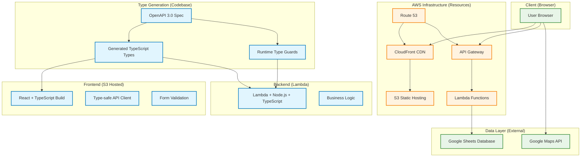

# Wedding Invitation Web Application

A production-grade serverless web application demonstrating advanced full-stack engineering practices. Built with end-to-end type safety, infrastructure automation, and cost-optimized cloud architecture.

## Architecture



## Core Engineering Principles

### End-to-End Type Safety

**OpenAPI-Driven Development** with automatic code generation across the entire stack:

```typescript
// Single source of truth: openapi.yml
// ↓ Auto-generates TypeScript types
import type { components } from './generated/schema'

// ↓ Runtime validation with ts-auto-guard
import { isCreateUserInput } from './generated/input.guard'

// ↓ Type-safe API client
const api = fetcher.path('/users').method('post').create()
```

### Infrastructure as Code

**Zero-touch deployment** with Serverless Framework:

- Environment-agnostic configuration with parameterized FQDNs
- Security-first AWS resources (OAC, strict S3 policies)
- Pre-commit hooks ensure schema changes trigger type regeneration

### Cost Optimization

**Production-efficient architecture** designed for minimal operational costs:

- **ARM64 Lambda**: 34% better price-performance vs x86
- **128MB memory allocation**: Right-sized for workload
- **HTTP API**: Lower cost per request than REST API
- **CDN edge caching**: Reduces origin requests and Lambda invocations

## Technical Architecture

### Domain-Driven Design

```typescript
// Value Objects with branded types for type safety
export type UserEmail = string & { readonly brand: unique symbol }
export type FamilyNameKanji = string & { readonly brand: unique symbol }

// Advanced type constraints and validation
export const createUserEmail = (value: string): Result<UserEmail, ValidationError> =>
  isValidEmail(value) ? ok(value as UserEmail) : err(new ValidationError('Invalid email'))

// Repository pattern with functional dependency injection
export const saveUsers =
  (doc: GoogleSpreadsheet) =>
  (models: User[]): ResultAsync<User[], InternalServerError>
```

### Functional Error Handling

```typescript
// Railway-oriented programming with neverthrow
const result = ok(requestBody)
  .andThen(validateInput)
  .andThen(workflow)
  .asyncAndThen(saveUsers(docResult.value))
  .mapErr(mapToHttpError)
```

### Clean Architecture Layers

```text
backend/
├── api/           # Infrastructure (HTTP handlers)
├── workflows/     # Application (use cases)
├── objects/       # Domain (entities, value objects)
├── repos/         # Infrastructure (data access)
└── errors/        # Cross-cutting concerns
```

## Tech Stack

### Frontend

- **React 18** + **TypeScript** - Component-based UI with strict type safety
- **Tailwind CSS** - Utility-first styling with design system
- **React Hook Form** - Performant form validation integrated with OpenAPI types
- **Google Maps API** - Interactive location display

### Backend

- **AWS Lambda** + **Node.js** + **TypeScript** - Serverless functions with strict mode
- **OpenAPI 3.0** - API specification driving code generation
- **Serverless Framework** - Infrastructure as code with CloudFormation
- **AWS Lambda (ARM64)** - Cost-optimized serverless compute

### Infrastructure

- **AWS S3** + **CloudFront** - Global CDN with edge caching
- **API Gateway (HTTP API)** - Cost-efficient API routing
- **Route 53** - DNS management with SSL automation

### Development Excellence

- **ESLint** (Airbnb TypeScript) - Industry-standard code quality
- **Husky** + **lint-staged** - Automated quality gates
- **Pre-commit type generation** - Schema changes auto-generate code
- **Prism mock server** - API-first parallel development

## Development Workflow

```bash
# Type-safe development pipeline
yarn generate-api-schema    # OpenAPI → TypeScript types
yarn generate-input-guard   # TypeScript → Runtime validation

# Local development with hot reload
yarn sls offline            # Backend with serverless-offline
cd frontend && yarn start   # React dev server with HMR
```

## Key Technical Achievements

### Advanced Type System Implementation

- **Branded types** for domain modeling and compile-time safety
- **Discriminated unions** for exhaustive error handling
- **Generic type constraints** for flexible yet safe APIs
- **End-to-end type flow** from OpenAPI spec to runtime validation

### API-First Development

- **Contract-first design** with OpenAPI specification
- **Automatic type generation** ensures frontend/backend consistency
- **Runtime validation** with auto-generated type guards
- **Mock server integration** enables parallel development

### Functional Programming Patterns

- **Railway-oriented programming** for error composition
- **Pure functions** with explicit side effect management
- **Immutable data structures** throughout the application
- **Dependency injection** via currying and higher-order functions

### Performance & Cost Engineering

- **ARM64 Lambda functions** for optimal price-performance
- **Minimal bundle sizes** with tree shaking and code splitting
- **Edge caching strategy** reduces origin requests significantly
- **Resource right-sizing** based on actual usage patterns

### Security & Input Validation

- **Comprehensive input validation** at API gateway level
- **Branded types** prevent data corruption and mixing
- **CORS configuration** with environment-specific origins
- **Origin Access Control** for secure S3 access

## Project Structure

```text
├── backend/              # Clean architecture layers
│   ├── api/             # HTTP handlers (infrastructure)
│   ├── workflows/       # Business logic (application)
│   ├── objects/         # Domain models & value objects
│   └── repos/           # Data access (infrastructure)
├── frontend/src/        # React application
│   ├── components/      # Reusable UI components
│   ├── routes/          # Page-level components
│   └── lib/             # Type-safe API clients
├── generated/           # Auto-generated code (types, guards)
├── resources/           # CloudFormation templates
└── openapi.yml         # Single source of truth for API
```

---

_Demonstrates production-grade engineering practices: type safety, infrastructure automation, cost optimization, and architectural excellence_
